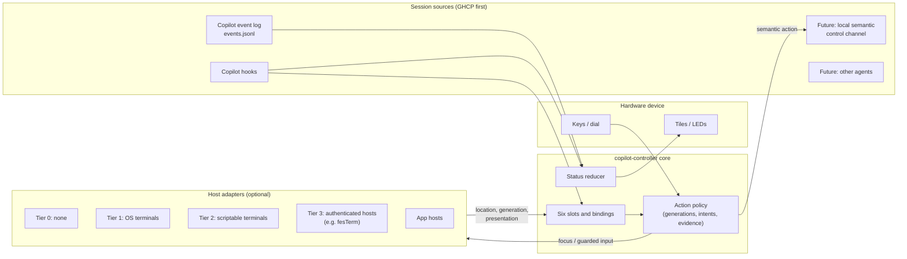
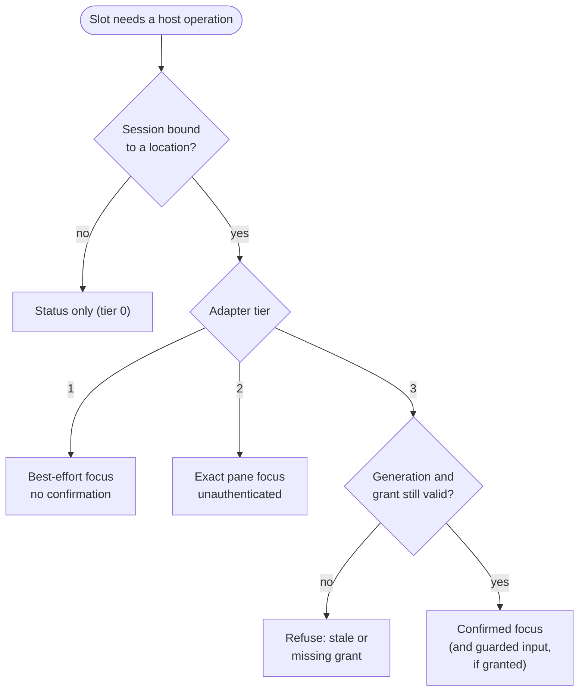
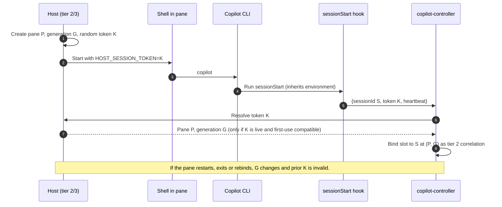
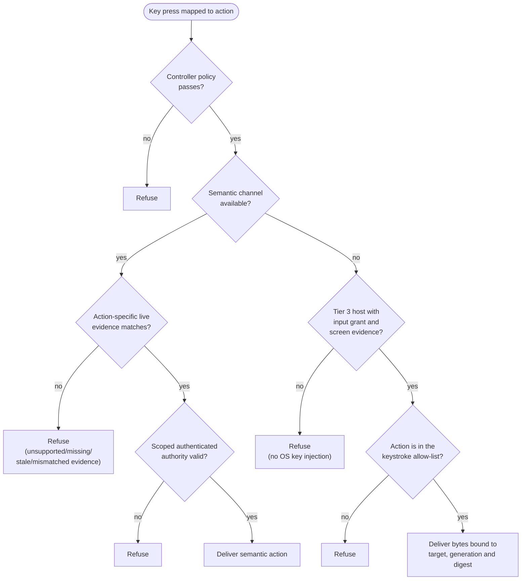
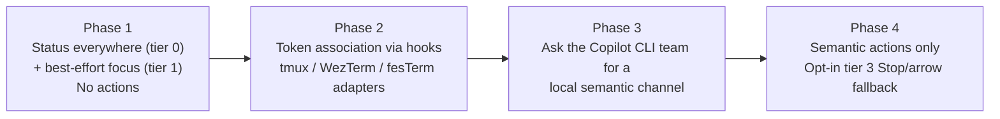

# Design proposal: Copilot-first host integration

| | |
|---|---|
| **Status** | Proposed, for discussion. Not part of the parity contract. |
| **Scope** | How `copilot-controller` connects to GitHub Copilot CLI sessions and to the terminals or apps that show them. |
| **Non-goals** | Changing current behavior. Nothing here permits action delivery today. |

## 1. Why this document exists

[`RECONSTRUCTION_BRIEF.md`](../../RECONSTRUCTION_BRIEF.md) and its appendices
define a read-only diagnostic foundation and an offline six-session engine. They
say the product is "not a complete interactive terminal controller." They list the
`integrated` host as a set of *unavailable* capabilities:

- discovery
- authentication
- association
- confirmed presentation
- same-run Stop

See [Platform and diagnostics §2.3](../../specs/PLATFORM_AND_DIAGNOSTICS.md).

This proposal describes how those capabilities could become available. It puts
**GitHub Copilot (GHCP) integration first**. Terminals and other apps are
**optional hosts** that add features when they cooperate. No host is required.

Because it widens the product boundary, it must not be merged into the parity
specs. If accepted, it should become a new, versioned specification layer.

## 2. Terminology

| Term | Meaning | What it proves | What failure means |
|---|---|---|---|
| **Session** | One Copilot CLI conversation, identified by its session UUID. | Nothing on its own. It is the unit each device slot is bound to. | — |
| **Session source** | The component that reports session status, such as the Copilot event log or hooks. | That Copilot reported a state change. | Status becomes `unknown`. It never guesses. |
| **Host** | The program showing a session, such as a terminal, multiplexer or app. | Nothing unless it is authenticated. | The controller falls back to a lower tier. |
| **Host adapter** | Controller code that talks to one host type. | Only what its tier allows (section 5). | It reports `unavailable` with a reason. |
| **Location** | The window, tab or pane currently showing a session. | That the session was shown there at a given generation. | The binding becomes stale and focus is refused. |
| **Generation** | A counter that increases each time a tab, pane or session restarts. | That a target is the same one that was bound. | Any mismatch rejects the operation. Targets are never silently switched. |
| **Association** | The link between a session and its location. | Depends on the method (section 6). | The slot keeps showing status but cannot focus. |
| **Confirmed presentation** | The host confirms the session is actually visible to the user. | That the user can see what an action will affect. | Actions that need visibility are refused. |
| **Semantic action** | An action expressed in Copilot terms, such as "approve request R" or "stop turn T". | That Copilot itself received a specific request. | The action is refused. There is no keystroke fallback. |
| **Keystroke action** | An action delivered as terminal input bytes. | Only that bytes were queued to a pane. | It is refused unless every tier 3 condition holds. |
| **Grant** | Permission given by a host or Copilot to the controller. It is scoped, time-limited and bound to a target. | That a user approved this kind of operation. | The operation is refused. Grants are never widened. |

## 3. The three questions

For each of the six slots, the controller answers three separate questions.
Each one has a different best source and a different level of risk.

| Question | Meaning | Best source | Risk |
|---|---|---|---|
| **Status** | Is the session working, waiting, complete or in error? | Copilot CLI | Low. A wrong status only shows a misleading colour. |
| **Location** | Where is the session shown, and can it be brought forward? | The host | Medium. A wrong location focuses the wrong window. |
| **Action** | How are Stop, Accept, Send and similar actions delivered safely? | Copilot CLI first, a host only as a fallback | High. A wrong action changes the user's work. |

## 4. What Copilot CLI offers today

| Interface | What it provides | Fit for the controller |
|---|---|---|
| **Session event log** (`events.jsonl` under the session-state directory) | Status for every local interactive session. | Already used. The event names match the [Copilot SDK event reference](https://github.com/github/copilot-sdk/blob/main/docs/features/streaming-events.md), so the format is partly documented but not a stable contract. |
| **Hooks** (`sessionStart`, `notification` and others) | Immediate notifications, run as child processes of Copilot. | Already accepted by the hook inbox. They can also carry an association token (section 6). |
| **Remote control** ([docs](https://docs.github.com/copilot/concepts/agents/copilot-cli/about-remote-access)) | Structured replies to permission requests, answers to questions and stopping turns, from GitHub.com or GitHub Mobile. | Close to the right kind of action channel, but it goes through GitHub's cloud and needs the organisation policy "View and control". It is not a local API. |
| **ACP server** (`copilot --acp`, [docs](https://github.com/github/docs/blob/main/content/copilot/reference/copilot-cli-reference/acp-server.md)) and the **Copilot SDK** | Full structured control of sessions. | The controlling program owns the session. It cannot attach to an interactive session the user started in a terminal. |

**Conclusion:** Copilot already supports safe, structured actions through remote
control. The cleanest design is a **local version of that channel** that this
controller can use. That would remove the need to infer Copilot's screen state
from terminal contents. Section 8 explains what to ask for.

## 5. Host tiers

Each host adapter reports exactly what it can do. Every missing capability
returns an explicit `unavailable` reason, as the current platform spec already
requires. Higher tiers only add features. Status must work at tier 0.

| Tier | Examples | Locate session | Bring forward | Confirm visible | Send input |
|---|---|---|---|---|---|
| **0: none or unknown** | Headless, unrecognised host | No | No | No | No |
| **1: observed OS terminal** | Windows Terminal, Terminal.app, iTerm2, VS Code terminal | Process tree, best effort | OS window activation, best effort | No | **No** |
| **2: scriptable terminal** | tmux, WezTerm, kitty, iTerm2 Python API | Exact pane identity through the host's API | Yes | Partly | Possible but unauthenticated. Off by default. |
| **3: authenticated cooperating host** | fesTerm (optional) | Token plus generation | Through the host's command model | Yes | Only through grants bound to target and generation |
| **App hosts** | VS Code Copilot Chat, other Copilot surfaces | Through each app's own API | Varies | Varies | Varies |

### What each tier proves

- **Tier 1** proves only that a process tree and a window existed when sampled.
  Process IDs can be reused, so the existing creation-time identity checks still
  apply. Focus is a convenience, never confirmed presentation.
- **Tier 2** proves that the multiplexer reported a pane ID. Anyone running as
  the same user can drive the same API, so this is not authentication.
- **Tier 3** proves that an authenticated host with a user-approved grant says
  a specific target, at a specific generation, is showing the session.

## 6. Associating a session with a location

| Method | Strength | Works with | Notes |
|---|---|---|---|
| **Host token in the environment** | Correlation only (unauthenticated) | Tier 2 and tier 3 hosts that can set per-pane environment variables | The host creates a random token for each pane and generation. Copilot inherits it, and so do its hooks. The `sessionStart` hook reports `{sessionId, token}`. The host maps the token to a pane as correlation evidence only. |
| **Process-tree matching** | Medium | Tier 1 | Walk from the Copilot process to its terminal ancestor. Only Windows observation exists today. |
| **Window or tab title** | Weak | Any | Display label only. Never used for targeting. |

Rules:

- A slot binds to a **session**, not a pane. One pane can run several Copilot
  sessions over time. One session is shown in at most one location at a time.
- Tokens are correlation hints, never identity authentication, action grants or
  authorisation.
- Token scope is explicit: `{host target, pane, generation, claimed session}`.
  Claims outside that scope are refused.
- Tokens are single-purpose and short-lived. They expire, and are invalidated on
  pane restart, pane exit, session exit and host-side rebind.
- First-use semantics are strict. The first accepted `{session, token}` claim
  wins that token scope. Exact duplicates may be idempotent for reliability, but
  never extend expiry and never rebind to another session or target.
- Conflicts (same token with different session/target/generation) mark
  association `unconfirmed` and require operator-visible refusal for focus or
  action routing.
- Tier 2 remains unauthenticated correlation, because descendants or same-user
  processes can copy inherited environment values and replay them.
- Any claim of authenticated association requires independent authenticated
  live-session evidence bound to the exact host target and generation, plus tier
  3 host attestation. If unavailable, report `unconfirmed association` instead
  of implying token authenticity.
- Non-conflicting correlation can still support unauthenticated tier 2 focus.
  It never proves confirmed presentation or permission to act.
- The current Windows-shaped `session_root` and the opaque or native target split
  remain. Host-provided targets are a new tagged target kind and cannot be
  converted into another kind.
- **Assumption to verify:** hooks inherit Copilot's environment, so they can read
  the token.

## 7. Action safety

Two independent checks are always required:

1. The controller's own action policy: generation match, three-second intent
   lifetime, duplicate-reservation tracking and same-run Stop.
2. Action-specific, user-approved authenticated authority plus matching live
   state evidence.

A button press alone is never permission.

### Where the evidence comes from

The policy needs evidence about Copilot's UI state. Examples are whether a dialog
is open, what kind of selection it has, and whether the draft has changed.

| Path | Evidence | Strength | Privacy cost |
|---|---|---|---|
| **Semantic channel** | Copilot's own action-specific live evidence: request ID/kind, turn ID or composer/mode/history revision | Strong | Low. No screen contents needed. |
| **Tier 3 screen evidence** | Host-derived dialog and composer fingerprints | Medium. It depends on Copilot's screen layout. | High. It needs a terminal-contents grant. |
| **OS key injection** | None | — | Rejected, as in the current spec |

**Recommendation:** use semantic actions for `accept`, `send`, `autopilot` and
`fork`. Allow only `stop` and the four directions through the tier 3 keystroke
fallback, and only if the user opts in.

### Proposed semantic evidence requirements (API contract)

| Action | Required live evidence | Required authority scope |
|---|---|---|
| **Accept / answer** | Pending request **ID and kind** both match | Approve-or-answer authority for that request kind and target |
| **Stop** | Current **turn ID** matches and session is in the same run | Stop authority for that session and run |
| **Send** | Composer revision (or equivalent freshness token) matches, plus exact prompt binding | Send authority for that session and prompt submission |
| **Autopilot mode change** | Mode state/revision matches requested transition | Mode-change authority scoped to that transition |
| **Fork** | Source session/history revision matches plus exact fork parameters | Fork authority scoped to source and parameters |

These are proposed API requirements, not assumptions about undocumented current
capabilities. IDs and revisions are evidence, not grants. The endpoint must
atomically validate evidence, check authority, and consume request/reservation
state so duplicates or TOCTOU races are rejected safely.

## 8. What to ask the Copilot CLI team for

A **local semantic control channel** for interactive sessions, similar to remote
control but without the cloud:

- **Discovery:** list live interactive sessions with session ID, process ID and
  start time.
- **Authentication:** a per-user local endpoint, such as a Unix socket or named
  pipe restricted to the user, with an explicit pairing step.
- **State:** current turn ID, pending permission or question requests with IDs
  and kinds, composer revision (or equivalent freshness), mode state/revision
  and forkable history revision.
- **Authority:** explicitly scoped, authenticated grants per action family and
  target, with expiry and revocation.
- **Actions:** answer request R, stop turn T, submit a prompt, switch mode or
  fork. Each action must provide action-specific live evidence and is refused if
  unsupported, missing, stale or mismatched.
- **Audit:** every action appears in the session's event log with its source.

This keeps action safety explicit: evidence proves freshness and target; grants
prove approval scope. It also makes the controller independent of the host for
most actions.

## 9. fesTerm as an optional tier 3 host

fesTerm is one possible tier 3 adapter. The controller must work fully without it.

| Concern | fesTerm mechanism |
|---|---|
| Transport and identity | Authenticated MCP client with an Ed25519 key (fesTerm ADR 0074, Proposed) |
| Status and metadata | Status grant that lasts until revoked |
| Focus | `SwitchSession` through the application command model, using a typed tab ID and generation |
| Input | Input grant (15 minutes or until revoked), bound to the exact target, encoded-input digest and length (ADR 0065, Proposed). Queued input is never replayed. |
| Association | Per-tab, per-generation token for unauthenticated correlation, plus authenticated live-session attestation for confirmed association (section 6) |
| Screen evidence | Terminal-contents grant, used only for the keystroke fallback |

Open question: should fesTerm **show** controller status, for example as slot
badges on tab chips? That would require data flowing from the controller into
fesTerm. Alternatively, fesTerm could read Copilot status itself, but then two
reducers could disagree. This proposal recommends **one** status source, owned
by the controller.

## 10. Remote sessions and multiple hosts

- **SSH and dev tunnels:** the event log and hooks live on the remote machine.
  Status needs a relay, such as a small remote agent or host-forwarded hook
  traffic. This is deferred. The first release covers local sessions only.
- **Multiple hosts:** each binding records its host adapter. Two hosts showing the
  same session is a conflict, so the binding becomes `unknown` rather than
  choosing one.

## 11. Concerns and objections

1. **This changes the product boundary.** The parity contract excludes action
   delivery. This must be a new spec layer with its own acceptance tests.
2. **The event log is not a stable API.** Keep it behind a session-source
   interface and test against recorded sessions.
3. **Remote control may be disabled by policy** in some organisations. Do not
   depend on it until its availability is confirmed.
4. **Screen evidence is fragile.** It breaks when Copilot changes its layout and
   it reads private terminal contents. Treat it as a fallback, not the plan.
5. **Other agents should wait.** Keep the session-source interface clean, but do
   not build non-Copilot integrations yet.

## 12. Suggested phases

| Phase | Exit criteria |
|---|---|
| 1 | Status is correct for local sessions in any host. Focus reports `best_effort` and never claims confirmation. |
| 2 | Token correlation binds slots to exact panes and generations. Tests cover spoof/replay/stale/expiry/conflict handling, including unconfirmed-association refusal paths. |
| 3 | A written decision from the Copilot CLI team on a local channel. |
| 4 | Every action is refused unless controller policy plus action-specific evidence and scoped authority all pass. Recorded-session tests cover missing/wrong/stale evidence, missing/wrong grants, duplicate consumption and valid same-run Stop without any pending request. |

## 13. Decisions needed

- [ ] Should the main action path be a local Copilot channel, or should we plan
      around terminal keystrokes?
- [ ] Which hosts come first after tiers 0 and 1, such as tmux, WezTerm, fesTerm
      or VS Code?
- [ ] Should there be one controller-owned status source, or should hosts compute
      status themselves?
- [ ] Should the first release cover local sessions only?
